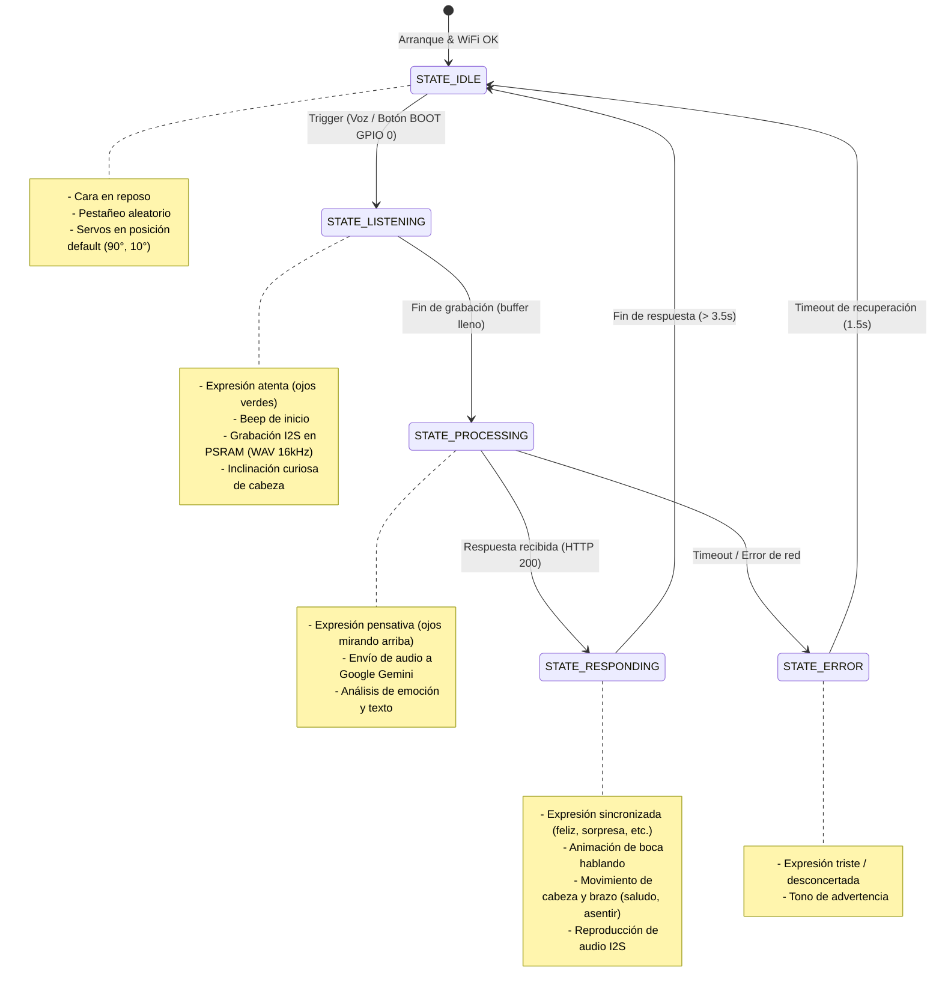

# Máquina de Estados Finitos (FSM) - GimenAI

El firmware de **GimenAI** implementa una Máquina de Estados Finitos no bloqueante para coordinar concurrentemente la captura de audio, la reproducción sonora, el renderizado de expresiones en la pantalla TFT y el control de los servomotores sin congelar la ejecución.

---

## Diagrama de Estados

---

## Detalle de Estados

| Estado | Expresión Pantalla | Acción de Servos | Acción de Audio | Siguiente Transición |
| :--- | :--- | :--- | :--- | :--- |
| **STATE_IDLE** | `EXPR_NEUTRAL` con pestañeo cada ~4s | Posición de reposo (90°, 10°) | Silencio / Monitor de escucha | Al presionar botón o detectar activación -> `STATE_LISTENING` |
| **STATE_LISTENING** | `EXPR_LISTENING` (indicador verde) | Inclinación de atención (`think`) | Graba por I2S0 (INMP441) hacia buffer PSRAM con cabecera WAV | Tras completar 4 segundos -> `STATE_PROCESSING` |
| **STATE_PROCESSING** | `EXPR_THINKING` (mirada arriba + puntos) | Inmóvil o ligero cabeceo | Espera respuesta de red | Al recibir JSON -> `STATE_RESPONDING`, si falla -> `STATE_ERROR` |
| **STATE_RESPONDING** | `EXPR_TALKING`, `EXPR_HAPPY`, etc. | Gesto contextual (`greet`, `nod`) | Reproduce respuesta por I2S1 (MAX98357A) | Tras finalizar reproducción -> `STATE_IDLE` |
| **STATE_ERROR** | `EXPR_SAD` | Retorno suave a neutro | Tono grave de error (300 Hz) | Tras 1.5s -> `STATE_IDLE` |
